# Session Z-Cloud: ZIGi's panel, panel polish round 2 (owner follow-up, 2026-10-11)

Local production builds (`PUBLIC_ALPHA_UNDEPLOYED`, `next start`): **before** = `feature/session-z-cloud` at `aa4c849`
(Part 2's panel), **after** = `feature/session-z-cloud` at `15c36a5`. Playwright's Chromium in the `chrome` channel; phones 320–430 px (touch, the phone
layout), computers 768–1440 px. The connected panel with two replies, answered by a **MOCK** local OpenAI-compatible server
(`tests/zigi-oneline-z.spec.ts` with `ZIGI_ONELINE_CAPTURES`). JPEG at most 900 px wide.
The rule and its measurements: `docs/verification/z-cloud/ZIGI_UI_AUDIT.md` ("Panel polish round 2") and ADR-019 C45.

| Width | Before | After |
|---|---|---|
| mobile 320 px | 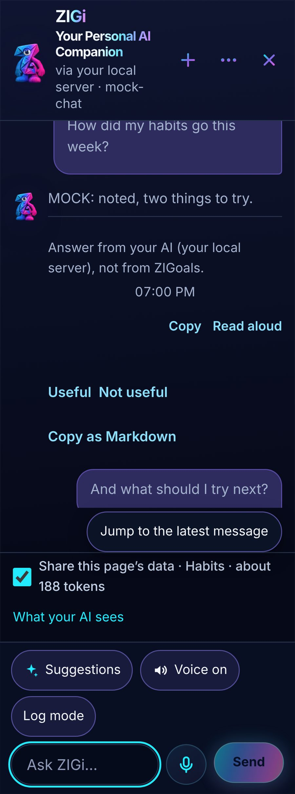 | 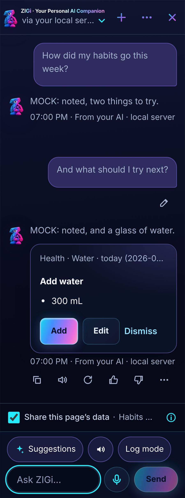 |
| mobile 360 px | 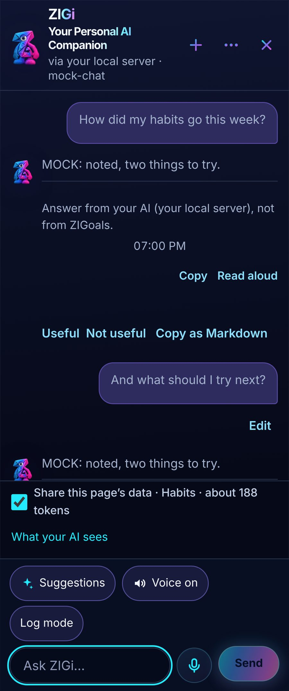 | 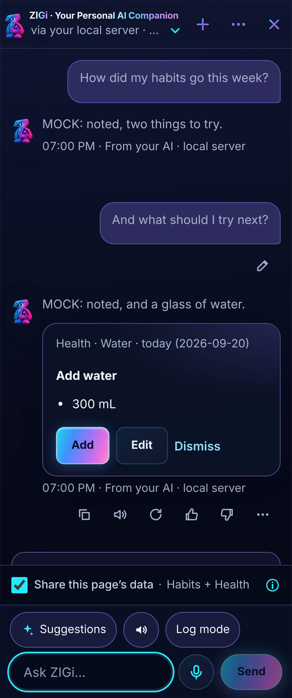 |
| mobile 390 px | 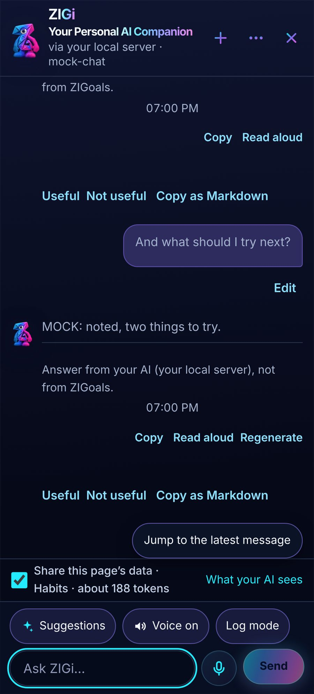 | 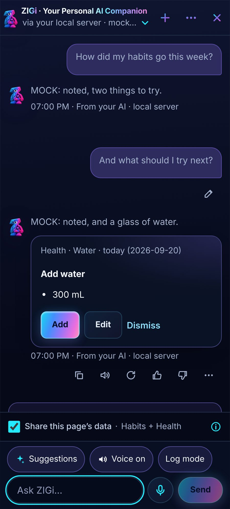 |
| mobile 430 px | 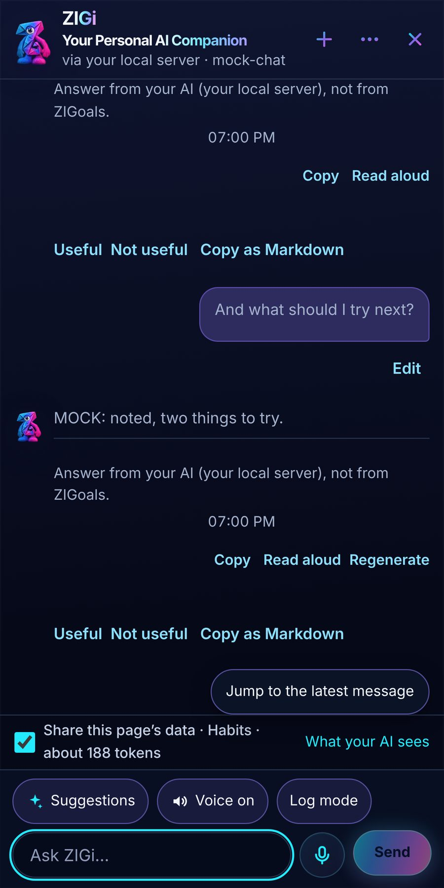 | 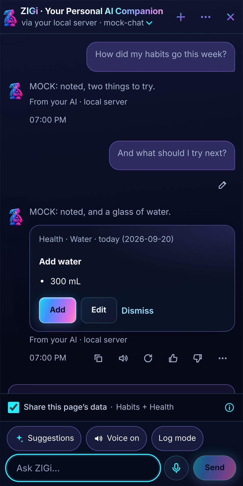 |
| desktop 768 px | 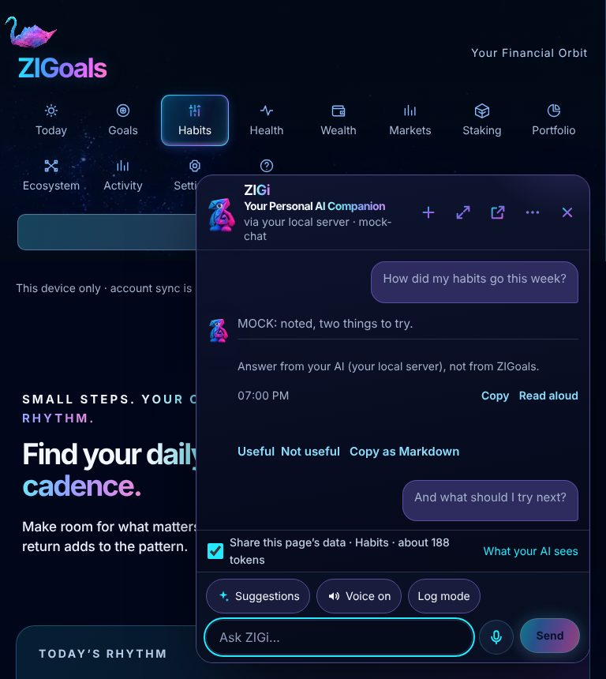 | 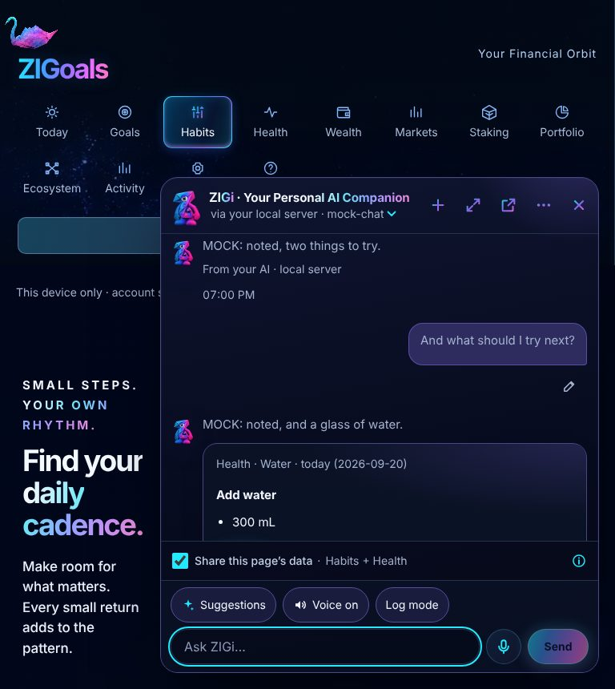 |
| desktop 1024 px | 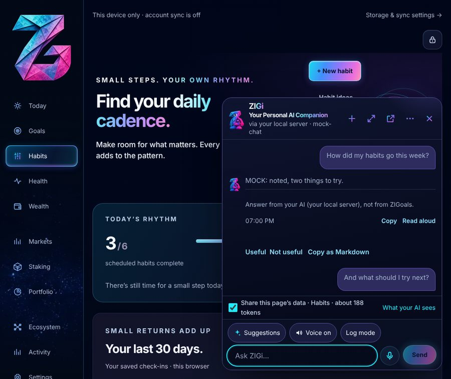 | 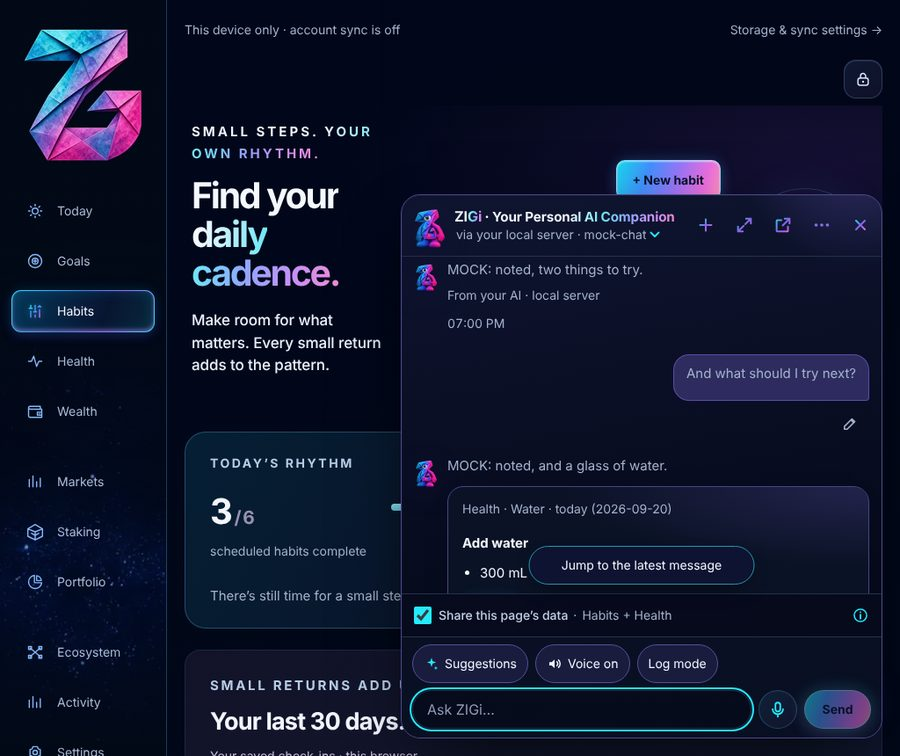 |
| desktop 1440 px | 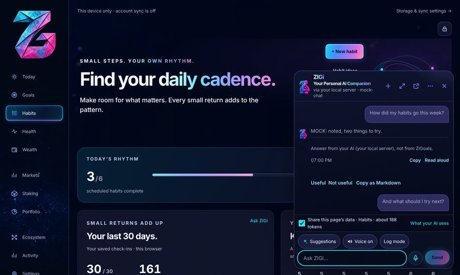 | 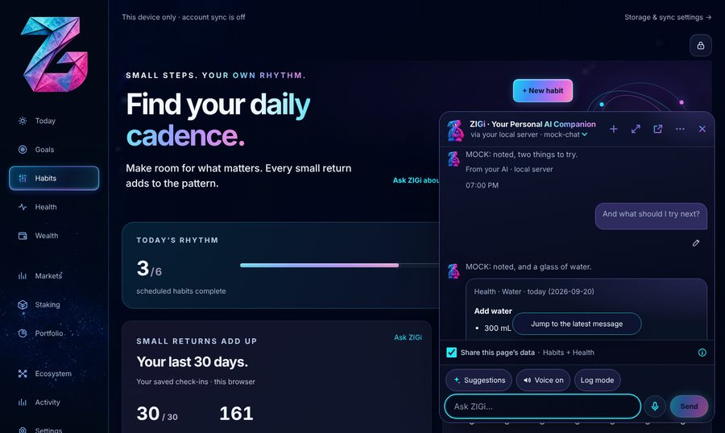 |

## Every ZIGi surface after the fixes (item 10's scan)

| Surface | Widths |
|---|---|
| cards and toast | [320](after/surfaces/320-cards-and-toast.jpg) · [360](after/surfaces/360-cards-and-toast.jpg) · [390](after/surfaces/390-cards-and-toast.jpg) · [430](after/surfaces/430-cards-and-toast.jpg) · [768](after/surfaces/768-cards-and-toast.jpg) · [1024](after/surfaces/1024-cards-and-toast.jpg) · [1440](after/surfaces/1440-cards-and-toast.jpg) |
| connected empty | [320](after/surfaces/320-connected-empty.jpg) · [360](after/surfaces/360-connected-empty.jpg) · [390](after/surfaces/390-connected-empty.jpg) · [430](after/surfaces/430-connected-empty.jpg) · [768](after/surfaces/768-connected-empty.jpg) · [1024](after/surfaces/1024-connected-empty.jpg) · [1440](after/surfaces/1440-connected-empty.jpg) |
| customize | [320](after/surfaces/320-customize.jpg) · [360](after/surfaces/360-customize.jpg) · [390](after/surfaces/390-customize.jpg) · [430](after/surfaces/430-customize.jpg) · [768](after/surfaces/768-customize.jpg) · [1024](after/surfaces/1024-customize.jpg) · [1440](after/surfaces/1440-customize.jpg) |
| header more | [320](after/surfaces/320-header-more.jpg) · [360](after/surfaces/360-header-more.jpg) · [390](after/surfaces/390-header-more.jpg) · [430](after/surfaces/430-header-more.jpg) · [768](after/surfaces/768-header-more.jpg) · [1024](after/surfaces/1024-header-more.jpg) · [1440](after/surfaces/1440-header-more.jpg) |
| history | [320](after/surfaces/320-history.jpg) · [360](after/surfaces/360-history.jpg) · [390](after/surfaces/390-history.jpg) · [430](after/surfaces/430-history.jpg) · [768](after/surfaces/768-history.jpg) · [1024](after/surfaces/1024-history.jpg) · [1440](after/surfaces/1440-history.jpg) |
| model switcher | [320](after/surfaces/320-model-switcher.jpg) · [360](after/surfaces/360-model-switcher.jpg) · [390](after/surfaces/390-model-switcher.jpg) · [430](after/surfaces/430-model-switcher.jpg) · [768](after/surfaces/768-model-switcher.jpg) · [1024](after/surfaces/1024-model-switcher.jpg) · [1440](after/surfaces/1440-model-switcher.jpg) |
| not connected panel | [320](after/surfaces/320-not-connected-panel.jpg) · [360](after/surfaces/360-not-connected-panel.jpg) · [390](after/surfaces/390-not-connected-panel.jpg) · [430](after/surfaces/430-not-connected-panel.jpg) · [768](after/surfaces/768-not-connected-panel.jpg) · [1024](after/surfaces/1024-not-connected-panel.jpg) · [1440](after/surfaces/1440-not-connected-panel.jpg) |
| receipts and undo | [320](after/surfaces/320-receipts-and-undo.jpg) · [360](after/surfaces/360-receipts-and-undo.jpg) · [390](after/surfaces/390-receipts-and-undo.jpg) · [430](after/surfaces/430-receipts-and-undo.jpg) · [768](after/surfaces/768-receipts-and-undo.jpg) · [1024](after/surfaces/1024-receipts-and-undo.jpg) · [1440](after/surfaces/1440-receipts-and-undo.jpg) |
| reply more | [320](after/surfaces/320-reply-more.jpg) · [360](after/surfaces/360-reply-more.jpg) · [390](after/surfaces/390-reply-more.jpg) · [430](after/surfaces/430-reply-more.jpg) · [768](after/surfaces/768-reply-more.jpg) · [1024](after/surfaces/1024-reply-more.jpg) · [1440](after/surfaces/1440-reply-more.jpg) |
| setup chooser | [320](after/surfaces/320-setup-chooser.jpg) · [360](after/surfaces/360-setup-chooser.jpg) · [390](after/surfaces/390-setup-chooser.jpg) · [430](after/surfaces/430-setup-chooser.jpg) · [768](after/surfaces/768-setup-chooser.jpg) · [1024](after/surfaces/1024-setup-chooser.jpg) · [1440](after/surfaces/1440-setup-chooser.jpg) |
| suggestions ideas | [320](after/surfaces/320-suggestions-ideas.jpg) · [360](after/surfaces/360-suggestions-ideas.jpg) · [390](after/surfaces/390-suggestions-ideas.jpg) · [430](after/surfaces/430-suggestions-ideas.jpg) · [768](after/surfaces/768-suggestions-ideas.jpg) · [1024](after/surfaces/1024-suggestions-ideas.jpg) · [1440](after/surfaces/1440-suggestions-ideas.jpg) |
| suggestions your day | [320](after/surfaces/320-suggestions-your-day.jpg) · [360](after/surfaces/360-suggestions-your-day.jpg) · [390](after/surfaces/390-suggestions-your-day.jpg) · [430](after/surfaces/430-suggestions-your-day.jpg) · [768](after/surfaces/768-suggestions-your-day.jpg) · [1024](after/surfaces/1024-suggestions-your-day.jpg) · [1440](after/surfaces/1440-suggestions-your-day.jpg) |
| suggestions yours | [320](after/surfaces/320-suggestions-yours.jpg) · [360](after/surfaces/360-suggestions-yours.jpg) · [390](after/surfaces/390-suggestions-yours.jpg) · [430](after/surfaces/430-suggestions-yours.jpg) · [768](after/surfaces/768-suggestions-yours.jpg) · [1024](after/surfaces/1024-suggestions-yours.jpg) · [1440](after/surfaces/1440-suggestions-yours.jpg) |
| voice first use | [320](after/surfaces/320-voice-first-use.jpg) · [360](after/surfaces/360-voice-first-use.jpg) · [390](after/surfaces/390-voice-first-use.jpg) · [430](after/surfaces/430-voice-first-use.jpg) · [768](after/surfaces/768-voice-first-use.jpg) · [1024](after/surfaces/1024-voice-first-use.jpg) · [1440](after/surfaces/1440-voice-first-use.jpg) |
| voice listening | [320](after/surfaces/320-voice-listening.jpg) · [360](after/surfaces/360-voice-listening.jpg) · [390](after/surfaces/390-voice-listening.jpg) · [430](after/surfaces/430-voice-listening.jpg) · [768](after/surfaces/768-voice-listening.jpg) · [1024](after/surfaces/1024-voice-listening.jpg) · [1440](after/surfaces/1440-voice-listening.jpg) |
| what your ai sees | [320](after/surfaces/320-what-your-ai-sees.jpg) · [360](after/surfaces/360-what-your-ai-sees.jpg) · [390](after/surfaces/390-what-your-ai-sees.jpg) · [430](after/surfaces/430-what-your-ai-sees.jpg) · [768](after/surfaces/768-what-your-ai-sees.jpg) · [1024](after/surfaces/1024-what-your-ai-sees.jpg) · [1440](after/surfaces/1440-what-your-ai-sees.jpg) |
